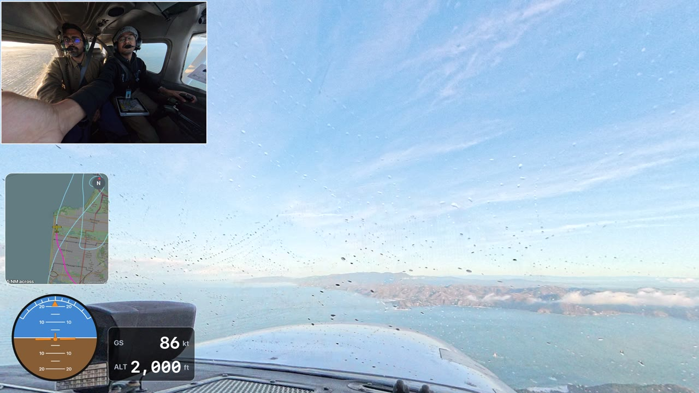

# 360 Views

Turn 360° camera footage into a normal video you'd actually want to watch. You choose:
- a **main view**: where it looks and how wide
- a **picture-in-picture inset**: for example the cockpit
- an optional **flight-data overlay**: moving map, attitude indicator, groundspeed and altitude from your GPS/EFB track

You can also export a real **360 video** for YouTube.

[](https://www.youtube.com/watch?v=_DO8uVuTrDQ)

▶ **Example video:** https://www.youtube.com/watch?v=_DO8uVuTrDQ

## What it does

- **Stitches straight from the camera file**, using the lens calibration the camera stores in each recording. There's no slow 360 intermediate.
- **Live preview** in your browser: drag a view to aim it, scroll to zoom. When you pause, the preview swaps in a full-quality frame.
- **Gyro stabilization** from the camera's own motion sensor. It removes rocking and shake but keeps real turns.
- **Flight-data overlay** from a track file:
  - **KML** from ForeFlight, Garmin Pilot, Sentry or Stratux
  - **GPX** from any GPS logger or phone app
  - **CSV** with time, lat and lon columns (altitude, speed, pitch and bank are optional)
  - **Auto-sync** lines the track up with the video by matching the horizon to the bank angle.
- **Trim, projects, parallel rendering**, using hardware encoding when your computer has it.
- **360 export:** a full equirectangular video with the metadata YouTube needs.

## Supported cameras

Insta360 dual-lens cameras that record both lenses into one `.insv` file. The app was developed on the **X4**. Other models (X3, ONE X2, ONE RS 1-Inch 360…) use the same file format.

If the seam between the two lenses looks off on your camera, open ☰ Projects and click **Align lenses**. It measures your camera's alignment from its own footage, which takes a few minutes.

Other camera families can be added: see *Architecture* below.

## Install

You need **Python 3.9+** and **ffmpeg**.

| | |
|---|---|
| macOS | `brew install python ffmpeg` ([Homebrew](https://brew.sh)) |
| Linux | `sudo apt install python3 python3-venv ffmpeg` (or your distro's equivalent) |
| Windows | Python from [python.org](https://www.python.org/downloads/), then `winget install Gyan.FFmpeg` |

Then download this folder and start it:

| | |
|---|---|
| macOS | double-click **`start.command`** (the first time: right-click → Open) |
| Linux | `./start.sh` |
| Windows | double-click **`start.bat`** |

The first launch sets up its own Python environment in `.venv`, which takes about a minute. The app then opens in your browser at http://127.0.0.1:8360. It runs entirely on your computer, and nothing is uploaded.

To check your setup, run `./start.sh doctor` (or `python -m views360 doctor`).

## Using it

1. **☰ Projects → New project.** Choose the camera's `VID_…_00_….insv` recording, either from the memory card or wherever you copied it.
   - The matching low-res `LRV_….lrv` preview is found automatically.
   - If you don't have one, the app makes a preview, which takes a few minutes.
2. **Aim the views.** Drag in the preview, or type exact yaw, pitch, roll and FOV. Resize and move the inset.
3. **Flight data (optional).** Click **Load track…** and pick your KML, GPX or CSV. Use Auto-sync, or nudge the offset until the attitude indicator matches the horizon.
4. **Trim** with *Set in* / *Set out* (keys `I` / `O`).
5. **Render.**
   - Choose the resolution, codec and output folder.
   - *Parallel chunks* renders several pieces at once and joins them losslessly.
   - Tick **360 video** for a YouTube 360 upload instead.

Projects, settings and caches are kept in your user data folder, not in the app folder, so you can update or move the app freely:
- macOS: `~/Library/Application Support/360 Views`
- Linux: `~/.local/share/360-views`
- Windows: `%APPDATA%\360 Views`

Set `VIEWS360_HOME` to use another folder.

The app never modifies your camera files.

### Settings file

`prefs.json` in the data folder holds:
- `outdir`: the output folder
- `chunks`: the default number of parallel chunks
- `tileUrl` / `tileAttribution`: the map tiles, which default to OpenStreetMap and must follow the [OSM tile policy](https://operations.osmfoundation.org/policies/tiles/). Point `tileUrl` at another `{z}/{x}/{y}` tile server if you have one.

Environment overrides:
- `VIEWS360_FFMPEG` / `VIEWS360_FFPROBE`: paths to the ffmpeg tools
- `VIEWS360_SOFTWARE=1`: CPU encoding only

## Command line

```
python -m views360 [RECORDING.insv] [--port 8360] [--out FOLDER] [--chunks N] [--no-browser]
python -m views360 doctor                                    # system check
python -m views360 stitch IN.insv OUT.mp4 [--width 7680]     # plain 360 stitch, no UI
```

## Architecture

```
views360/
  server.py     local HTTP server + API (thin; all logic lives in the modules below)
  web/          the browser UI (single file; WebGL preview stitching)
  projects.py   projects: camera file, preview, settings, track, lens alignment
  camera.py     camera adapters (CAMERA_TYPES); Insta360 .insv implementation, remap tables, preview builder
  stitch360.py  lens model (Mei omnidirectional), calibration reader, alignment fit, CLI stitcher
  render.py     settings → ffmpeg filter graphs; render job (parallel chunks, join, audio, 360)
  gyro.py       motion-sensor extraction and stabilization corrections
  autosync.py   horizon-tilt ↔ bank-angle matching
  track.py      KML / GPX / CSV track loading
  hud.py        moving map, attitude indicator, data panel (Pillow)
  hudfeed.py    per-chunk instrument renderer process
  spherical.py  YouTube 360 metadata (V1 XMP + V2 sv3d), no external tools
  system.py     platform layer: ffmpeg discovery, hardware encoder/decoder choice, file dialogs, doctor
  paths.py      data folder, caches, preferences
```

- **Another camera family:** write a class with the same interface as `camera.Camera` (described in its docstring) and add it to `CAMERA_TYPES`.
- **Another track format:** add a loader to `track.Track`.
- **Another instrument:** add a renderer in `hud.py` and register it in `HudEngine`.

## Notices

This project was created with AI assistance.

Licensed under the Apache License 2.0 (see [LICENSE](LICENSE)). Map data © OpenStreetMap contributors.
